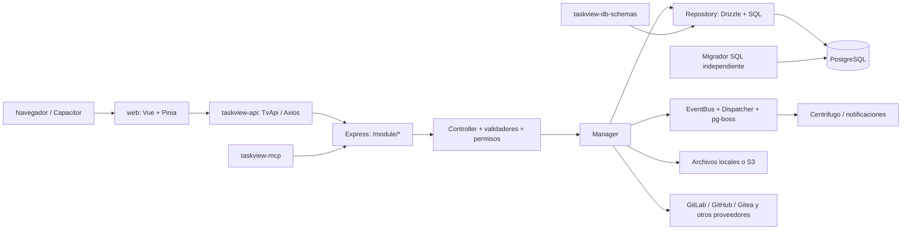

# 01 — Arquitectura actual

Auditoría Lista 01, 2026-11-13. Fuente local: commit `b5a7e6598d927fe2e8a5936150093390c31ed13c`, inicialmente `main`, descripción `v1.58.2-5-gb5a7e65`. Versiones declaradas raíz/API/web: 1.58.2. Las conclusiones de implementación son estáticas; no equivalen a regresión ejecutada. Ver [pruebas](07-informe-pruebas.md) y [versionamiento](05-respaldo-versionamiento.md).

## Estructura y responsabilidades

Las tres rutas solicitadas existen. Es un monorepositorio pnpm con una SPA Vue y un backend Express modular; no hay evidencia para denominarlo DDD o arquitectura limpia.

| Ruta real | Responsabilidad |
|---|---|
| `package.json`, `pnpm-workspace.yaml`, `pnpm-lock.yaml`, `.npmrc` | Scripts de coordinación, enlaces `workspace:^`, lockfile 9.0 y `engine-strict=true`. El workspace también declara `site/*`; no existe ese directorio en este checkout. |
| `web/src/main.ts`, `web/src/bootstrap.ts` | Arranque, Vue Router, Pinia, Nuxt UI, i18n y registro de extensiones. Las rutas están en bootstrap, no en `web/src/router/`. |
| `web/src/pages/`, `web/src/components/features/` | Páginas y componentes por función: tareas, listas, Kanban, sprints, organizaciones, colaboración, etc. |
| `web/src/stores/`, `web/src/composables/`, `web/src/helpers/` | Estado Pinia, acciones, preferencias, sincronización y cliente HTTP. |
| `web/src/extensions/`, `web/android/`, `web/ios/` | Puntos de extensión del frontend y empaquetado móvil Capacitor. No constituyen por sí solos un sistema completo de plugins de backend. |
| `api/server.ts`, `api/src/App.ts`, `api/src/routes/index.ts` | Validación de entorno, servidor y montaje de rutas. |
| `api/src/tv-modules/` | Módulos con Routes → Controller → Manager → Repository; middleware de permisos y tipos/validadores próximos al módulo. Hay convenciones heredadas y SQL directo junto con Drizzle. |
| `api/src/core/`, `api/src/modules/`, `api/src/middlewares/` | Usuario por solicitud, permisos, eventos, trabajos, conexión PostgreSQL, CORS y errores. |
| `taskview-packages/taskview-db-schemas/src/schemas/` | Modelos Drizzle compartidos y algunos validadores ArkType. No contiene todas las restricciones ni triggers del SQL. |
| `api/src/migrations/taskview/`, `api/src/migrations/migrate.ts` | Instalación SQL, manifiesto ordenado de migraciones y ejecutor propio; no es un flujo `drizzle-kit push`. |
| `taskview-packages/taskview-api/src/` | SDK TypeScript `TvApi`, contratos y clientes HTTP; no es el servidor. |
| `taskview-packages/taskview-mcp/`, `taskview-packages/capacitor-widget-bridge/` | Acceso MCP y puente móvil. |
| `web__old/` | Frontend histórico con su propio manifiesto/lockfile; no incluido en el workspace activo. No usar como base de la personalización. |
| `taskview-plugin/`, `.claude-plugin/`, `ideas/`, `docs/`, `CLA/` | Recursos de integración, propuestas, documentación y condiciones de contribución; no implican funcionalidad desplegada. |

## Inventario tecnológico

Versiones resueltas leídas del lockfile, no paquetes instalados localmente:

| Tecnología | Versión/evidencia | Función |
|---|---|---|
| Vue / Vue Router / Pinia | Vue 3.5.27, Pinia 2.3.1; Router declarado `^4.6.4` en `web/package.json` | SPA y estado |
| Nuxt UI / Tailwind | Nuxt UI 4.4.0; Tailwind declarado `^4.1.18` | UI con plugin Vite; no se encontró servidor Nuxt SSR |
| TypeScript / Vite web | 5.9.3 / 7.3.1 | Tipos y compilación |
| Express / Vite API | 4.21.0 / 5.4.21 | HTTP y empaquetado del servidor |
| Drizzle / node-postgres | 0.44.7 / 8.20.0 | ORM y SQL; `pg` fijado por override raíz |
| ArkType / Zod | ArkType 2.1.20; Zod declarado 3.x API y 4.x web | Validación mixta, conservar contratos al extender |
| Axios | 1.13.5 declarado en API/web/SDK | SDK, autenticación e integraciones |
| JWT / bcryptjs / Passport | `jsonwebtoken ^9.0.2`, `bcryptjs ^2.4.3`, `passport ^0.7.0` | Sesiones, contraseñas y proveedores sociales |
| Node | API exige `>=24 <25`; Dockerfiles usan `24.22.2-alpine`; host tiene 20.19.5 | La condición raíz `>=18` es insuficiente |
| pnpm / Bun | web fija pnpm 10.28.1; `api dev` usa Bun | Ambos ausentes en host; Bun no es necesario para ejecutar el bundle Node |
| PostgreSQL | Compose original 17; instalado 17.12 | Datos, triggers y cola pg-boss |
| Vitest / Playwright / lint | API Vitest 2.1.9; SDK declara `^3.2.4`; Playwright, ESLint web, Biome API | Verificación; existen bloqueos de configuración |
| Capacitor, Tiptap, Vue Flow, vuedraggable, Chart.js | `web/package.json` | Móvil, notas enriquecidas, grafo, arrastre y gráficos |
| pg-boss, Centrifugo, Firebase, emailjs, AWS SDK | `api/package.json`, `api/src/core/` | Trabajos persistentes, tiempo real, push, correo y archivos S3 opcionales |

## Componentes

`web/src/plugins/axios.ts` instancia `TvApi`, instala el token Bearer y coordina refresh; `web/src/helpers/axios.ts` activa credenciales. `web/src/helpers/serverConfig.ts` toma `window.__TASKVIEW_CONFIG__`; `web/docker-runtime-config.sh` lo genera desde `TASKVIEW_API_URL`. Esa configuración prevalece sobre el servidor guardado. Sin ella, el modo desarrollo apunta a 1401 y producción al servicio público; es esencial fijarla en el laboratorio.

`App.ts` añade Helmet, CORS y `res.tvJson({response: ...})`, captura cuerpos de webhooks y construye `AppUser`. `GoalPermissionsFetcher` combina permisos de propietario/roles con restricciones de tokens; los middleware resuelven el proyecto desde los recursos. `AuthRoutes`, `AuthManager`, `AuthModel`, `SessionStorage` implementan login, JWT y sesiones revocables; también existen OAuth, SAML/OIDC y SCIM. No se ha realizado una prueba de penetración.

## Persistencia y despliegue

`api/src/modules/db.ts` usa un Pool y sesiones UTC. Esquemas principales: `tasks`, `tv_auth`, `collaboration`, `tasks_auth`, `history`, `tv_files`, `app` y `about`; pg-boss añade su persistencia. Hay reglas de negocio en triggers y en TypeScript, por lo que revisar solo Drizzle sería insuficiente.

`FilesManager`, `FilesRepository` y `files/storage/FileStorageFactory.ts` seleccionan almacenamiento local o S3. `tv_files.files` guarda metadatos/proveedor y `tv_files.file_to_task` enlaces. Existen cuotas, tamaño máximo, hashes y enlaces de descarga temporales. La instalación actual monta archivos y logs por bind; PostgreSQL usa `taskview_pgdata`.

Los Dockerfiles empaquetan artefactos ya compilados: `api/dockerfile`, `web/dockerfile`, `api/postgresql/dockerfile`. El servidor usa PM2; el frontend nginx. `api/dev-containers-test/docker-compose.yml` comparte los puertos 1725/8888 con la instalación actual: no ejecutarlo. No hay Compose raíz. El nuevo archivo aislado se explica en [04](04-entorno-desarrollo.md).

## Scripts reales

| Objetivo | Comando del repositorio | Observación |
|---|---|---|
| Instalar | `pnpm install --frozen-lockfile` | Usar Node 24 y pnpm 10.28.1; no ejecutado |
| Paquetes | `pnpm run build:packages` | SDK y esquemas; web añade puente Capacitor |
| Web | `pnpm run dev:webapp`, `pnpm run build:webapp` | Vite 5174; build ejecuta tipos |
| API | `pnpm run dev:api`, `pnpm run build:api` | dev requiere Bun; build no migra |
| Docker API/migrador | `pnpm --dir api run build:docker`, `pnpm --dir api run build:migration` | Solo producen bundles; copiar recursos según 04 |
| Tipos | `pnpm --filter web-nuxt-ui typecheck`, `pnpm --filter taskview-ce-api-server type-check` | Intentados, bloqueados por pnpm ausente |
| Lint | `pnpm --filter web-nuxt-ui lint`, `pnpm --filter taskview-ce-api-server lint` | No ejecutados; evitar `check`, `format`, `lint:fix` que escriben |
| Pruebas | `pnpm --dir api exec vitest run`, `pnpm --dir web test:e2e` | No ejecutar sin corregir destinos de prueba |

No se cambiaron dependencias ni archivos de aplicación.
