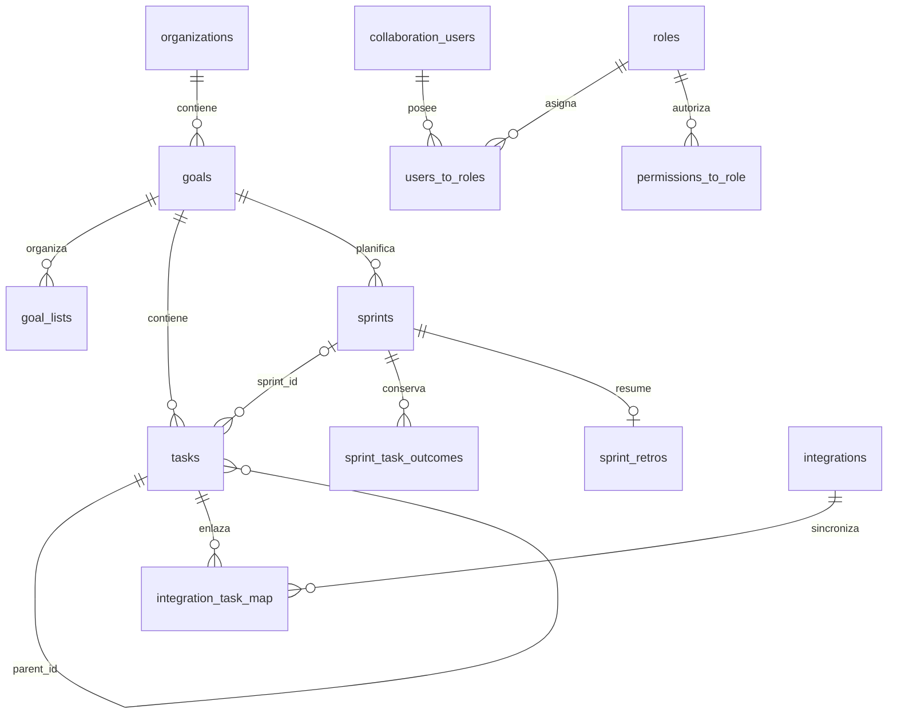

# 03 — Modelo de datos y permisos

Fuente: esquemas en `taskview-packages/taskview-db-schemas/src/schemas/`, migraciones SQL en `api/src/migrations/taskview/sql/` y managers/repositorios del commit `b5a7e65`. En la base activa solo se consultó versión; no se extrajeron usuarios, registros de negocio ni un volcado de esquema. Las relaciones siguientes describen el código, no una certificación de todas las constraints instaladas.

Es un diagrama conceptual; nombres sin esquema para legibilidad. Las FK completas están en SQL. Drizzle omite varias FK que sí se incorporan en migraciones.

## Entidades e invariantes

| Concepto | Persistencia y comportamiento verificable |
|---|---|
| Proyecto | `tasks.goals`: propietario, organización, archivo, `estimate_unit` (points/hours), `backlog_version`. `goal` no es una épica ni el compromiso Product Goal. |
| Lista | `tasks.goal_lists.goal_id`; agrupación opcional de tareas. |
| Tarea / subtarea | `tasks.tasks.goal_id`, `goal_list_id`, `parent_id`. `TasksRepository.referencesOutsideGoal` recorre ancestros y rechaza ciclos, padres inexistentes y referencias fuera del proyecto; invocado por `TasksManager`. |
| Estado | `tasks.statuses` por proyecto; `status_id`, `task_order`, `kanban_order`; prioridad 1/2/3 y `complete` independiente. SQL mantiene `date_complete`; mover de columna no debe presumirse validación QA. |
| Sprint | `tasks.sprints`: fechas, objetivo `goal_text`, resultado `goal_achieved`, capacidad, pausa, estados draft/planned/active/review/completed. SQL 1.53.0 valida fechas y agrega FK de tareas. |
| Asociación | `tasks.tasks.sprint_id` admite NULL y solo un sprint actual; `sprint_task_outcomes` conserva decisión/estimación al cierre. `SprintsManager` valida mismo proyecto y destino no completado. |
| Estimación y tiempo | `estimate_value` numérico; unidad en proyecto; `tasks.time_entries` y `history.time_entries` separados de puntos. Capacidad individual usa `tv_auth.users`; responsables usan `collaboration.users`. No intercambiar IDs. |
| Integración | `tasks.integrations.project_id` apunta a goals; `integration_task_map` tiene unicidad `(integration_id, issue_number)`, tarea y estado; `tasks.tasks.source_url` conserva origen. |
| Historia/eventos | Triggers escriben snapshots JSON en `history.tasks_tasks` y tablas de proyectos/listas; EventBus y dispatchers notifican procesos. Eventos en memoria no son un event store inmutable. |

`SprintsManager`: solo draft/planned pueden activarse; busca otro sprint active/review; active pasa a review; solo review cierra. `SprintsRepository.applyClose` usa transacción, guarda resultados y estimación; una tarea completa se acepta automáticamente. Puede eliminarse un sprint incluso completado y cascadan sus resultados/retro. Estos comportamientos requieren decisiones institucionales de conservación y QA, no deben confundirse con reglas universales Scrum.

## Jerarquía solicitada

La estructura puede representar un árbol genérico `proyecto → tarea épica → tarea historia → subtarea`, con tareas y bugs adicionales como hijos de la épica. No puede distinguir esos tipos ni imponer sus reglas actualmente. Usar etiquetas permitiría un prototipo visual, pero no integridad semántica ni informes fiables.

Limitación decisiva: `SprintsRepository.getBacklogTasksForPlanning`, `getSprintTasksForPlanning` y `sumEstimateForSprint` filtran `parent_id IS NULL`; una historia hija de épica quedaría fuera. Burndown consulta todas las tareas con sprint, mientras planificación/capacidad filtra raíces. Un árbol sin política de estimación puede duplicar puntos o esconder trabajo.

Alternativas para Lista 02 (solo propuestas, no objetos creados):

1. **Tipos sobre la tarea existente:** mantener IDs, adjuntos, historial, asignaciones y SDK; añadir después discriminador o tabla de extensión. Revisar filtros para seleccionar unidades planificables, y prohibir sumar simultáneamente contenedores y descendientes. Es la opción recomendada, condicionada a prototipo y regresión.
2. **Épica separada con relación a tareas raíz:** reduce cambios en planificación, pero añade joins y debe decidir cómo tratar historias con subtareas y migración de vínculos. Comparar antes de elegir.
3. **Listas/etiquetas como épicas/tipos:** menor coste inicial; insuficiente para jerarquía validada, relaciones bug-historia y auditoría. No recomendable como modelo definitivo.

Un bug debe tener un solo padre jerárquico y poder relacionarse con una historia mediante un vínculo adicional. `tasks.task_relations` puede aportar base técnica, pero su metadata actual no demuestra un vínculo funcional tipado “afecta a”. No usar `parent_id` simultáneamente para pertenencia a épica y relación opcional con historia.

## Autorización

`tv_auth.users` identifica cuentas; `collaboration.users` identifica colaboradores por email. `users_to_goals` concede pertenencia; `roles.goal_id` acota roles al proyecto; `users_to_roles` y `permissions_to_role` permiten N:M. `tv_auth.organization_members` tiene un rol único por organización/email. Ya existen múltiples roles de proyecto por persona: no crear un sistema paralelo.

`api/src/core/GoalPermissionsRepository.ts` obtiene permisos; `GoalPermissionsFetcher.ts` aplica pertenencia, propietario, scope de proyecto y permisos del token; `GoalPermissionsChecker.ts` verifica acciones. `api/src/types/auth.types.ts` enumera permisos y `tasks/tasks.server.types.ts` asocia campos a permisos. Los middleware de sprints/archivos resuelven goal desde el recurso. Mantener esta resolución también para toda futura referencia nueva.

`app-user-middleware.ts` distingue JWT y tokens API/OAuth; verifica cuenta/sesión y bloqueo. `SessionStorage.ts`, `AuthManager.ts`, `AuthModel.ts` y `auth/middlewares/is-logged-in.ts` completan el flujo. Hay permisos separados para ver/gestionar sprints, analítica, archivos, roles e integraciones. Las verificaciones visuales del frontend no reemplazan autorización del servidor.

PO, Scrum Master, Developer y responsabilidad QA son dimensiones funcionales. Pueden mapearse a roles existentes y una política explícita; no implican automáticamente administración de organización o acceso a todas las tareas. Para dos programadores, permitir acumulación de responsabilidades sin conceder permisos administrativos innecesarios.

## Posibilidades de ampliación

| Necesidad | Base actual / extensión que deberá evaluarse |
|---|---|
| Product Backlog | Tareas sin sprint, listas, prioridades y orden; faltan tipos, vista jerárquica y orden transversal consistente. |
| Sprint Backlog / Sprint Goal | Planificación, `sprint_id`, objetivo y estimaciones existentes; revisar selección de historias y subtareas. |
| Product Goal | Descripción del proyecto puede contener texto, pero falta compromiso estructurado/versionado. |
| Criterios de aceptación / DoD | Notas reutilizables como texto; faltan criterios verificables, versionado y vínculo de DoD al incremento. |
| QA | Estados/roles/archivos aportan base; faltan decisión, evidencias, revisor y reglas de cierre. `complete` hoy no prueba QA. |
| Review | Ciclo y outcomes existentes; añadir feedback y decisiones sobre producto según necesidad. |
| Retrospectiva | Texto wentWell/wentBad/actionItems; evaluar acciones con responsable/fecha y seguimiento. |
| Impedimentos | Grafo y tareas pueden expresar bloqueo técnico; falta registro con responsable, resolución e historia propios. |
| Roles múltiples | N:M ya disponible; definir política y comprobar unión efectiva de permisos. |
| GitLab | OAuth y mapeo issue/tarea reutilizables; eventos de ramas/commits/MR/pipelines requieren contratos y persistencia adicional. |

No se añadieron tablas, columnas, rutas, migraciones ni reglas de negocio.
