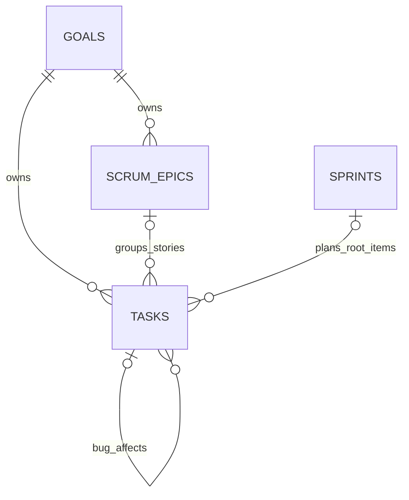

# Lista 02 — Modelo Scrum

## Estado técnico

El modelo y la API Scrum están implementados localmente sobre la migración 1.76.0. La API se probó contra la base desechable `taskview_l02_final2_20261115` (PostgreSQL 17.12, versión de aplicación 1.76.0). No se aplicó ninguna migración al laboratorio funcional ni a las bases de Lista 01. La ejecución y sus límites están en [02-pruebas-modelo.md](02-pruebas-modelo.md).

## Entidades

- `tasks.scrum_epics` contiene épicas con `title`, `details`, `archived` e `issue_key`. Una épica es un agrupador y no un registro ejecutable de tareas.
- `tasks.tasks` conserva su ID técnico y los campos históricos. `work_item_type` diferencia `story`, `task` y `bug`; las filas preexistentes mantienen `task`.
- `description` es el título funcional, `note` el detalle existente y `acceptance_criteria` los criterios de aceptación.
- `epic_id` enlaza historias a épicas; `related_task_id` enlaza bugs a una historia o tarea afectada. Ninguno de estos vínculos usa `parent_id`.
- `parent_id` mantiene exclusivamente la jerarquía de subtareas. Las rutas soportadas validan que padre e hijo pertenezcan al mismo proyecto y que no se forme un ciclo.
- Historias, tareas y bugs raíz conservan el modelo de sprint existente. La tabla de épicas queda fuera de la consulta de elementos ejecutables.

## Integridad y política

PostgreSQL aplica tipos válidos, relaciones del mismo proyecto, unicidad de claves legibles y claves foráneas. La API aplica además reglas de dominio, permisos, proyecto de sprint/estado, tipo de elemento relacionado y rechazo de épicas archivadas al asociar historias.

Las escrituras de jerarquía usan un bloqueo asesor transaccional compartido y una consulta recursiva antes de crear o cambiar `parent_id`. Se aplica a las rutas legacy, API Scrum, importación, restauración de historial y movimiento. Las pruebas concurrentes intentaron enlazar dos tareas entre sí; una actualización se confirmó y la otra devolvió conflicto.

Archivar una épica es lógico y no borra ni desasocia historias. Mover un elemento con relaciones Scrum incompatibles se rechaza dentro de la transacción, sin cambios parciales ni desvinculación automática. El movimiento que dejaría subtareas atrás se rechaza. El movimiento simple sin relaciones incompatibles sigue disponible y recibe clave del proyecto destino.

## Claves de negocio

La migración 1.76.0 incorpora claves visibles `P<goalId>-<n>` para épicas, historias, tareas y bugs. El contador por proyecto se comparte entre ambas tablas y se incrementa mediante trigger transaccional; una clave no se reutiliza después de archivar o eliminar un registro. `id` conserva su función de clave técnica. El prefijo es derivado del ID del proyecto y no configurable; no se cambian claves institucionales o referencias como `HU-01`.

## Alcance pendiente

No se incluye interfaz de backlog ni cambios visuales. Los criterios de aceptación se guardan en texto; todavía no se entrega una colección estructurada de criterios. La clave derivada `P<goalId>` es única y segura, aunque no permite prefijos personalizados como `COB`. La etapa visual corresponde a Lista 03.
